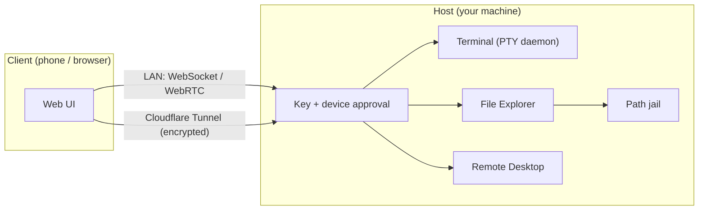

# 1Terminal - One Place for All Remote Coding

Self-hosted remote development workspace: multi-pane terminal IDE, 60fps desktop stream, file explorer with Git integration, Android device mirroring, Chrome browser automation, and 33+ AI coding agents with native structured chat. Access via LAN or Cloudflare Tunnel.

<div align="center">
  

  <br/>

  
</div>

---

## ⚡ Quick Start

**Linux / macOS:**
```bash
curl -fsSL https://raw.githubusercontent.com/jokerhung/1devterminal/master/install.sh | bash
```

**Windows (PowerShell):**
```powershell
irm https://raw.githubusercontent.com/jokerhung/1devterminal/master/install.ps1 | iex
```

Access the web interface:
- **Local:** `http://localhost:2208/workspace`
- **LAN:** `http://<your-ip>:2208/workspace`

### Auto-start on Login (Optional)

Start 9Remote automatically when you log in (Windows, macOS, Linux):

```bash
npm run autostart:on       # enable
npm run autostart:off      # disable
npm run autostart:status   # check current state
```

### Remote Access (Optional)

Use Cloudflare Tunnel for secure remote access:

```bash
# Install cloudflared
# macOS: brew install cloudflare/cloudflare/cloudflared
# Linux: wget -q https://github.com/cloudflare/cloudflared/releases/latest/download/cloudflared-linux-amd64.deb && sudo dpkg -i cloudflared-linux-amd64.deb
# Windows: winget install --id Cloudflare.cloudflared

# Create tunnel
cloudflared tunnel --url http://localhost:2208
```

Cloudflared will generate a public URL (e.g., `https://xxx.trycloudflare.com`) that securely proxies to your local instance.

---

## 📱 Supported Platforms

| Platform | Host | Client | Install |
|---|:---:|:---:|---|
| **macOS** | ✅ | ✅ | `curl -fsSL https://raw.githubusercontent.com/jokerhung/1devterminal/master/install.sh \| bash` |
| **Windows** | ✅ | ✅ | `irm https://raw.githubusercontent.com/jokerhung/1devterminal/master/install.ps1 \| iex` |
| **Linux** | ✅ | ✅ | `curl -fsSL https://raw.githubusercontent.com/jokerhung/1devterminal/master/install.sh \| bash` |
| **Web Browser** | — | ✅ | Access via `http://localhost:2208/workspace` or LAN IP |

Android device mirroring requires Android SDK Platform Tools (`adb`) and installed AVD for emulator control.

---

## ✨ 8 Superpowers

- 🤖 **Every Harness, One UI** — 33 AI coding CLIs, 8 with native structured chat.
- 🖥️ **Full Remote IDE** — persistent PTY terminals, multi-pane layout, built-in code editor.
- 📁 **File Explorer & Git** — browse, edit, transfer files and manage Git, all path-jailed.
- 🌐 **Remote Chrome Browser** — stream a real Chrome session from your host.
- 🤖 **AI Browser Automation** — agents drive Chrome through the `9r-browser` skill.
- 📱 **Localhost Preview & Android Mirroring** — preview local ports and mirror Android devices.
- 🖥️ **60fps Remote Desktop** — low-latency WebRTC screen streaming with clipboard sync.
- 📲 **Responsive Web Interface** — desktop and mobile layouts with a multi-host fleet view.

---

## 🛡️ Security Architecture



---

## 📂 Project Structure (Monorepo)

- **`host/`** — Node.js server that runs on your machine. Serves PTY terminals, streams desktop/browser, handles file operations, and integrates AI coding agents.- **`web/`** — Next.js web client interface deployed to Cloudflare Workers. Provides the UI for accessing the host.
- **`gitbook/`** — documentation site.
- **`scripts/`** — build and packaging tools.

The transport protocol (`host/transport/` and `web/shared/transport/`) is implemented on both sides.

### Development Setup

Clone and run from source:

```bash
# 1. Clone repository
git clone https://github.com/jokerhung/1devterminal.git
cd 1terminal

# 2. Install dependencies
npm install

# 3. Build and start
npm run host:build        # Build the host package
npm run dev:local         # Start host server + web client together

# Access at http://localhost:2208
```

**Development commands:**

```bash
npm run dev:local         # Host + web together (recommended)
npm run host:dev:server   # Host server only (port 2208)
npm run web:dev           # Web client only (Next dev on port 2200)

npm run host:build        # Build the host package
npm run host:sync         # Build + sync to local agent
```

**Stack:** JavaScript ES modules, React 19, Next.js, Socket.IO, WebRTC. Lint with `npx eslint .`.

---

## 📄 License

Apache License 2.0 — see [LICENSE](LICENSE). Free to use, modify, and distribute, including commercially. The "1terminal" name and branding are not covered by the license.
