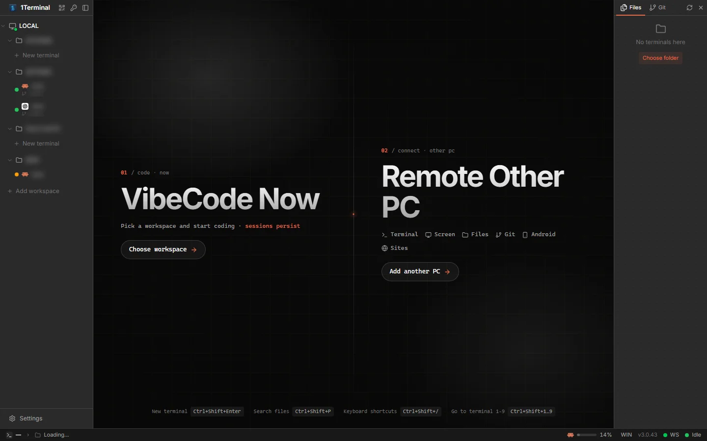
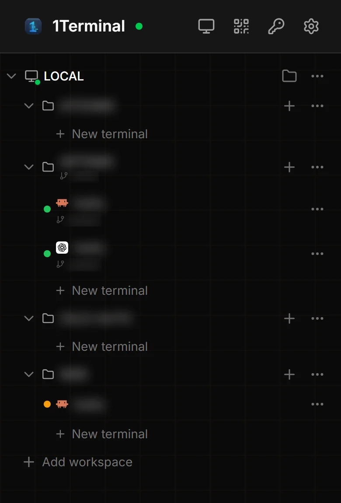
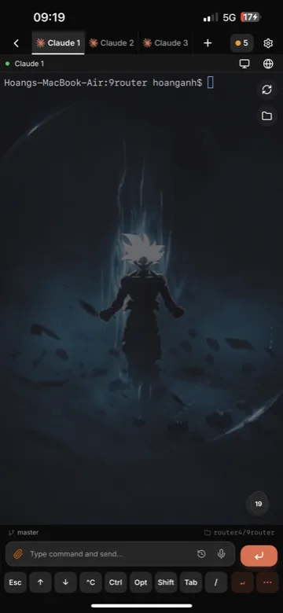
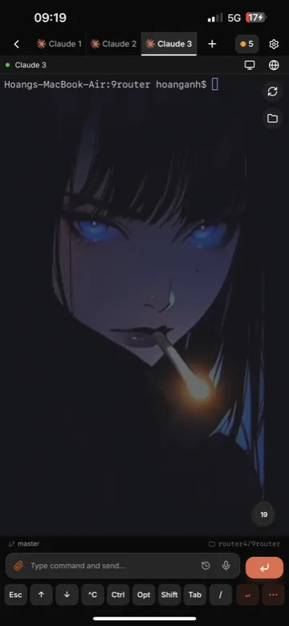

# 1Terminal - One Place for All Remote Coding

Self-hosted remote development workspace: multi-pane terminal IDE, 60fps desktop stream, file explorer with Git integration, Android device mirroring, Chrome browser automation, and 33+ AI coding agents with native structured chat. Access via LAN or Cloudflare Tunnel.

<div align="center">
  

  <table align="center">
    <tr>
      <td></td>
      <td></td>
      <td></td>
    </tr>
  </table>
</div>

---

## ⚡ Quick Start

**Linux / macOS:**
```bash
curl -fsSL https://raw.githubusercontent.com/jokerhung/1devterminal/master/install.sh | bash
```

**Windows (PowerShell):**
```powershell
irm https://raw.githubusercontent.com/jokerhung/1devterminal/master/install.ps1 | iex
```

The installer will:
1. Check and install Node.js and Git if needed
2. Clone the repository to `~/1terminal` (or `%USERPROFILE%\1terminal` on Windows)
3. Install dependencies and build the host package
4. Optionally create a system service for auto-start
5. Open `http://localhost:2208/workspace` in your browser

Access the web interface:
- **Local:** `http://localhost:2208/workspace`
- **LAN:** `http://<your-ip>:2208/workspace`

### Remote Access (Optional)

Use Cloudflare Tunnel for secure remote access:

```bash
# Install cloudflared
# macOS: brew install cloudflare/cloudflare/cloudflared
# Linux: wget -q https://github.com/cloudflare/cloudflared/releases/latest/download/cloudflared-linux-amd64.deb && sudo dpkg -i cloudflared-linux-amd64.deb
# Windows: winget install --id Cloudflare.cloudflared

# Create tunnel
cloudflared tunnel --url http://localhost:2208
```

Cloudflared will generate a public URL (e.g., `https://xxx.trycloudflare.com`) that securely proxies to your local instance.

### CLI Commands

| Command | Description |
|---|---|
| `1terminal ui` | Start web interface at `localhost:2208` |
| `1terminal start` | Headless server mode (systemd, Docker, SSH) |
| `1terminal browser chain --goal "…" --steps '[…]'` | AI browser automation |

---

## 📱 Supported Platforms

| Platform | Host | Client | Install |
|---|:---:|:---:|---|
| **macOS** | ✅ | ✅ | `curl -fsSL https://raw.githubusercontent.com/jokerhung/1devterminal/master/install.sh \| bash` |
| **Windows** | ✅ | ✅ | `irm https://raw.githubusercontent.com/jokerhung/1devterminal/master/install.ps1 \| iex` |
| **Linux** | ✅ | ✅ | `curl -fsSL https://raw.githubusercontent.com/jokerhung/1devterminal/master/install.sh \| bash` |
| **Web Browser** | — | ✅ | Access via `http://localhost:2208/workspace` or LAN IP |

Android device mirroring requires Android SDK Platform Tools (`adb`) and installed AVD for emulator control.

---

## ✨ 8 Superpowers

### 🤖 1. Every Harness, One UI

- **33 CLI harnesses** in the new-terminal catalog: Claude Code, Codex, GitHub Copilot, Cursor, OpenCode, Aider, Grok, Amp, Droid, Goose, Kilocode, Charm Crush, Qwen Code, Kimi, OpenClaude, Cline, Rovo Dev, Hermes, Devin, Auggie, Continue, Antigravity, Mistral Vibe, MiMo Code, Trae, Ante, Kiro, Codebuff, Prime Agent, Command Code, Autohand Code, Pi, OMP, and OpenClaw.
- **8 native structured-chat adapters** (Claude Code, Codex, OpenCode, Antigravity, OMP, Pi, Devin, Hermes) with live transcripts, thinking blocks, tool calls, file diffs, task lists, permission gates, question/elicitation cards, prompt queueing, and turn rewind where the engine supports it. 5 engines (Claude, Codex, OpenCode, Antigravity, Hermes) get the **9r-browser** skill auto-installed.
- Resume past conversations, switch model/effort/permission mode, browse each engine's skills and MCP servers, and use voice dictation (Web Speech or AI STT) to write prompts.
- Live usage and rate-limit tracking for Claude, Codex, Kimi, and Grok plans.
- Artifact inspector renders HTML, Markdown, Mermaid, SVG, and generated files beside the chat.
- When enabled in settings, the host registers its MCP server into agent CLIs, exposing artifact opening, task reporting, and fleet/kanban coordination tools.
- Push notifications when an agent finishes a turn or waits for your input.

### 🖥️ 2. Full Remote IDE

- **Persistent PTY daemon:** shells, builds, and AI agents stay alive across network switches, locked phones, tab closes, and host restarts.
- Multi-pane terminals with drag-to-resize splitters, session tabs, Git worktree creation/cleanup, branch badges, and mobile dev keys (`Esc`, `Tab`, `Ctrl`, `Alt`, arrows, `F1`–`F12`, sticky modifiers).
- CodeMirror editor with syntax highlighting for JS/TS, Python, Go, Rust, Java, PHP, SQL, HTML/CSS, YAML, and more.
- Preview images, video, PDF, Office documents, Markdown, and Mermaid without leaving the workspace.
- Command palette, fuzzy file search (⌘⇧P), file tree, workspace switcher, and customizable themes/backgrounds.

### 📁 3. File Explorer & Git (Path-Jailed)

- Browse, create, rename, delete, upload, and download files with chunked transfers.
- Git status, branch ahead/behind, side-by-side diffs, image diffs, commit/push/pull actions, and multi-worktree management.
- Repository scan across workspaces, changed-file badges, and `.gitignore` helpers.
- Every file operation goes through a strict path jail plus a sensitive-path deny list.

### 🌐 4. Remote Chrome Browser

- Stream a real Chrome/Chromium/Edge session from the host over the same low-latency transport, with dirty-tile diffing and adaptive quality.
- Browser profiles, tabs, address bar with history, console drawer, element inspect, annotations and markup overlays.
- Mobile device emulation, cookie import, and anti-detection defaults for testing real sites.
- Headless or headed Chrome, adoption of a live Chrome debugging port, and automatic idle reclaim for headless instances.

### 🤖 5. AI Browser Automation

- `1terminal browser` exposes a 14-op `chain` DSL (`go`, `wait`, `click`, `type`, `select`, `hover`, `enter`, `scroll`, `read`, `search`, `find`, `shot`, `run`, `upload`) with verified steps and self-healing.
- Agents discover it through the bundled **`9r-browser`** skill; a small decision model (Jev, free or OpenRouter preset) handles unknown labels and login flows.
- Run in an isolated profile or drive your real Chrome through the MV3 bridge extension — no debug banner required.

### 📱 6. Localhost Preview & Android Mirroring

- **Zero-config localhost preview:** a Service Worker bridge streams `localhost:3000`, `localhost:5173`, `localhost:8080`, or any local port to your phone — no port forwarding, no ngrok.
- Automatic port scanner finds local web servers behind Node, Vite, Next, Python, Rails, PHP, and more.
- **Android device/emulator mirroring** via scrcpy at up to 60fps: boot/stop AVDs, install/launch/clear/uninstall APKs, open deep links, and stream logcat.
- GitHub Codespaces list/create/start/connect, with devcontainer auto-start support.

### 🖥️ 7. 60fps Remote Desktop

- Hardware-accelerated screen streaming over direct WebRTC P2P with dirty-tile diffing and adaptive scale/quality.
- Mouse, touch, keyboard, multi-monitor switching, and OS cursor-shape sync.
- Two-way text clipboard sync between host and client.
- Falls back to WebSocket through the tunnel when P2P is unavailable.

### 📲 8. Responsive Web Interface

- Adaptive multi-column layout for desktop/tablet and touch-optimized interface for mobile browsers.
- Multi-host fleet view (up to 8 hosts) with live session/workspace status and in-place host switching.
- Persistent sessions and reconnect screens that keep long-running work alive across network changes.

---

## 🛡️ Security Architecture

1Terminal implements secure local and remote access:

- **Direct WebSocket/WebRTC transport:** terminals and file transfers use WebSocket; remote desktop uses WebRTC data channels for low latency.
- **Path jail:** file explorer enforces strict path boundaries and blocks sensitive system paths.
- **Workspace-scoped access:** optional workspace-level permissions with path restrictions.
- **Cloudflare Tunnel encryption:** when using cloudflared for remote access, traffic is encrypted end-to-end through Cloudflare's network.

---

## 📂 Project Structure (Monorepo)

- **`host/`** — Node.js server that runs on your machine. Serves PTY terminals, streams desktop/browser, handles file operations, and integrates AI coding agents. Published to npm as `1terminal`.
- **`web/`** — Next.js web client interface deployed to Cloudflare Workers. Provides the UI for accessing the host.
- **`gitbook/`** — documentation site.
- **`scripts/`** — build and packaging tools.

The transport protocol (`host/transport/` and `web/shared/transport/`) is implemented on both sides.

### Development Setup

Clone and run from source:

```bash
# 1. Clone repository
git clone https://github.com/jokerhung/1devterminal.git
cd 1terminal

# 2. Install dependencies
npm install

# 3. Build and start
npm run host:build        # Build the host package
npm run dev:local         # Start host server + web client together

# Access at http://localhost:2208
```

**Development commands:**

```bash
npm run dev:local         # Host + web together (recommended)
npm run host:dev:server   # Host server only (port 2208)
npm run web:dev           # Web client only (Next dev on port 2200)

npm run host:build        # Build npm package
npm run host:sync         # Build + sync to local agent
```

**Stack:** JavaScript ES modules, React 19, Next.js, Socket.IO, WebRTC. Lint with `npx eslint .`.

---

---

## 🔒 Distribution

The `1terminal` npm package is published from this repository. Install only from npm or build from source.

---

## 📄 License

Apache License 2.0 — see [LICENSE](LICENSE). Free to use, modify, and distribute, including commercially. The "1terminal" name and branding are not covered by the license.
